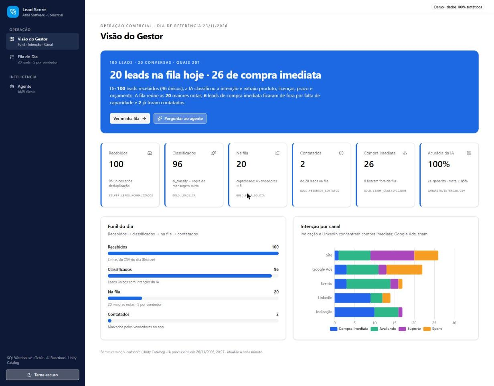
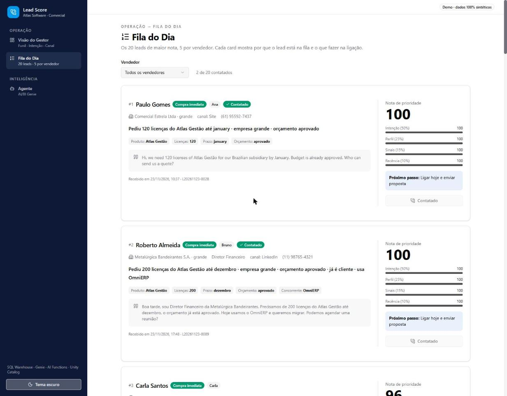
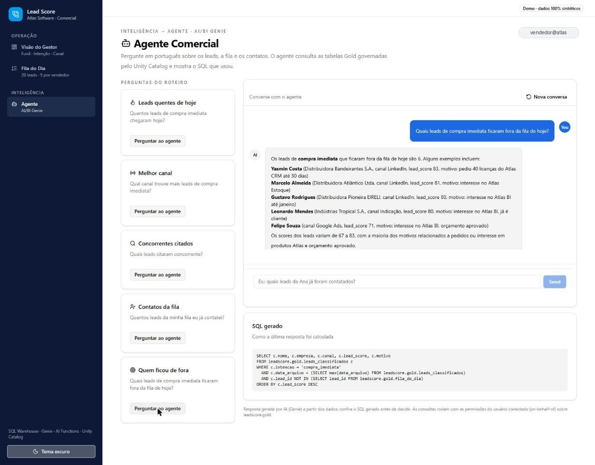

# Lead Score · os 20 leads certos do dia

> **100 leads por dia, capacidade para 20. Quais 20?**
> Priorização de leads com engenharia de dados + IA no Databricks, entregue ao time comercial como um Data App com agente conversacional.

`Databricks` · `Unity Catalog` · `Lakeflow (SQL)` · `AI Functions` · `AI/BI Genie` · `Databricks Apps (AppKit)` · `Declarative Automation Bundles`

Projeto do workshop **Jornada de Dados · Quem sabe faz ao vivo**. Cliente fictício: **Atlas Software**, empresa de software B2B. Todos os dados são sintéticos.

| | |
|---|---|
| Especificação | [`PRD_leadscore.md`](PRD_leadscore.md) |
| Roteiro da apresentação (50 min) | [`apresentacao/lead_score.html`](apresentacao/lead_score.html) |
| Tarefas e evidências (spec driven development) | [`.llm/`](.llm/README.md) |
| Data App publicado | `https://leadscore-leadscorews-7474647553344962.aws.databricksapps.com` (login do workspace) |

---

## A dor

A Atlas Software recebe **cerca de 100 leads por dia** (site, LinkedIn, eventos, indicações e Google Ads). O time comercial tem **4 vendedores** e cada um faz **5 conversas de qualidade por dia**: só **20 leads** são atendidos, e 80 ficam sem contato.

Hoje os 20 são escolhidos **por ordem de chegada ou por intuição**, lendo mensagem por mensagem. Leads prontos para comprar se perdem no meio de curiosos, pedidos de suporte e spam, e esfriam antes do contato. **A conversão está em torno de 3%.**

A causa-raiz é que o sinal de compra existe, mas está:

- **escondido em texto livre**: "preciso de 200 licenças do Atlas Gestão até dezembro, orçamento aprovado";
- **espalhado em fontes separadas**: o lead (formulário), a empresa (cadastro) e o histórico comercial (CRM).

Ler e cruzar 100 mensagens por dia com cadastro e histórico não cabe na rotina de quem vende.

## A entrega de valor

| | Hoje | Com Lead Score |
|---|---|---|
| Critério de escolha | Ordem de chegada | Nota de 0 a 100, explicável |
| Tempo de triagem por vendedor | ~30 min/dia | ~0: a fila chega pronta |
| Conversão dos 20 contatados | ~3% | meta ≥ 12% |
| Vendas por mês (22 dias úteis) | ~13 | ~53 (cenário ilustrativo) |

**Mesmo time, mesma verba de marketing, 4× mais vendas.** O ganho vem só de escolher melhor.

- **Vendedor:** abre o app e vê os seus 5 leads do dia, com o motivo de cada um estar na fila e o próximo passo.
- **Gestor comercial:** acompanha o funil (recebidos → classificados → na fila → contatados) e pergunta em português ao agente quem ficou de fora.
- **Marketing:** vê que canal traz comprador, e não só volume (indicação e LinkedIn concentram compra, Google Ads concentra spam).
- **Engenharia:** pipeline incremental, reprocessável e governado no Unity Catalog; a IA roda uma vez por lead novo.

É um **produto de dados**: tem dono (engenharia + gestor comercial), usuários, contrato (fila pronta até 8h, leads novos em até 15 min) e qualidade medida (expectations no pipeline e acurácia da IA contra um gabarito).

## Como funciona

```
CSVs do dia ──► Volume raw ──► Bronze ──► Silver ──► Gold ──────────────► Data App
(leads,         (Unity         (como      (limpo,    (ai_classify +        (Fila do Dia,
 empresas,       Catalog)       chegou)    dedup,     ai_extract +          Visão do Gestor,
 histórico)                                unido)     nota + fila)          Agente Genie)
```

| Camada | Objetos (catálogo `leadscore`) | O que faz |
|---|---|---|
| Landing | Volumes `landing.raw` e `landing.gabarito` | Porta de entrada dos CSVs e o gabarito para medir a IA |
| Bronze | `bronze.leads_raw`, `empresas_raw`, `oportunidades_raw` (streaming tables) | Auto Loader: cada arquivo lido uma vez; datas inválidas vão para `_rescued_data` |
| Silver | `silver.leads_normalizados`, `silver.leads`, `silver.empresas`, `silver.historico_empresa` | E-mail e CNPJ normalizados (dígito verificador), 1 lead por e-mail (o mais recente), junção com empresa e histórico, expectations |
| Gold | `gold.leads_ia`, `gold.leads_classificados`, `gold.fila_do_dia`, `gold.feedback_contatos` | IA incremental, nota, motivo e próximo passo por regra, os 20 da fila (5 por vendedor) e o feedback do app |

**A IA no SQL**: `ai_classify` responde "em qual caixa esse texto cai?" (`compra_imediata`, `avaliando`, `suporte`, `spam`) e `ai_extract` responde "que dados estão escondidos nele?" (produto, licenças, prazo, orçamento aprovado, cargo, concorrente). Sem endpoint e sem infraestrutura extra.

**A nota**:

```
lead_score = 0,50 × intenção + 0,25 × perfil + 0,15 × sinais + 0,10 × recência
```

Spam tem nota 0; suporte fica fora da fila comercial. Todo lead mostra os 4 componentes: o vendedor sempre sabe **por que** o lead está ali.

## As telas do app

### Visão do Gestor



**Para quem:** gestor comercial e marketing.
**O que entrega:**
- O resumo do dia numa frase: **20 leads na fila · 26 de compra imediata**, quantos ficaram de fora por falta de capacidade (6) e quantos já foram contatados.
- Seis KPIs com a origem de cada número: recebidos (100), classificados (96 únicos), na fila (20), contatados, compra imediata (26) e a acurácia da IA contra o gabarito (100%, meta ≥ 85%).
- O **funil do dia** (recebidos → classificados → na fila → contatados), que mostra onde a operação trava.
- A **intenção por canal**, que responde ao marketing onde investir: indicação e LinkedIn trazem compra; Google Ads e site trazem spam e suporte.

### Fila do Dia



**Para quem:** vendedor.
**O que entrega:**
- Os **20 leads de maior nota, 5 por vendedor**, com filtro por vendedor. Acaba a triagem de 30 minutos.
- Em cada card: nota de prioridade, os **4 componentes** (intenção, perfil, sinais, recência), o **motivo** ("Pediu 200 licenças do Atlas Gestão até dezembro · empresa grande · orçamento aprovado · já é cliente · usa OmniERP"), as entidades que a IA tirou do texto, a mensagem original e o **próximo passo**.
- O botão **Marcar como contatado**, que grava em `gold.feedback_contatos`. É o dado que vai medir a conversão real em produção.
- O lead herói chegou às 17h48: pela ordem de chegada seria o 89º; com a nota, está entre os primeiros.

### Agente Comercial



**Para quem:** gestor e marketing, sem depender de analista.
**O que entrega:**
- Perguntas em português sobre os leads, a fila e os contatos, respondidas por um **Genie Space** sobre as tabelas Gold.
- As 5 perguntas do roteiro com um clique (ex.: "Quais leads de compra imediata ficaram fora da fila de hoje?" → **6 leads**).
- O **SQL gerado** ao lado de cada resposta: resposta de IA sem mostrar como foi calculada não serve para tomar decisão.
- Execução **on-behalf-of**: o agente consulta com as permissões de quem está usando o app.

---

## Setup

A sequência abaixo é a que foi usada neste projeto. Workspace: profile `leadscore` da Databricks CLI; catálogo `leadscore`; bundle `lh_leadscore`, target `dev`.

### 1. Ferramentas

```bash
databricks --version   # Databricks CLI ≥ 1.0 (usado: 1.27)
uv --version           # Python 3.12, venv e build do wheel
gh --version           # GitHub CLI
claude --version       # Claude Code
node --version         # Node 22 + npm, para o Data App
```

Instalação, se faltar algo:

```powershell
# Windows · PowerShell
winget install Databricks.DatabricksCLI
powershell -ExecutionPolicy ByPass -c "irm https://astral.sh/uv/install.ps1 | iex"
winget install GitHub.cli
irm https://claude.ai/install.ps1 | iex
```

```bash
# macOS
brew tap databricks/tap && brew install databricks
curl -LsSf https://astral.sh/uv/install.sh | sh
brew install gh
curl -fsSL https://claude.ai/install.sh | bash
```

### 2. Autenticar no Databricks

Use um profile com nome (`leadscore`) e passe `--profile leadscore` em todo comando, para nunca publicar no workspace errado.

```bash
databricks auth login --host https://SEU-WORKSPACE.cloud.databricks.com --profile leadscore
databricks auth profiles
databricks current-user me --profile leadscore   # chamada real de API: se responde, o login vale
```

### 3. Código e ambiente Python

```bash
gh repo clone alerrandrofrederik/leadscore
cd leadscore/lh_leadscore

uv python pin 3.12
uv venv --seed
uv sync --dev

databricks aitools install   # skills oficiais do Databricks para o Claude Code (profile leadscore)
```

O projeto nasceu de `databricks bundle init` (template `default-python`, serverless). Antes do primeiro deploy, ajuste o `host` em `databricks.yml` para o seu workspace.

### 4. Catálogo, schemas e volumes

A Databricks CLI executa um statement por chamada, por isso os scripts usam um bloco `BEGIN … END`. Schemas e volumes ficam fora do bundle porque, em `mode: development`, o bundle os renomearia para `dev_<usuario>_bronze`.

```bash
databricks experimental aitools tools query --file src/sql/setup_ambiente.sql --profile leadscore   # catálogo, schemas e volumes
databricks experimental aitools tools query --file src/sql/udf_cnpj.sql       --profile leadscore   # funções de CNPJ
databricks experimental aitools tools query --file src/sql/verificacao/t0_4_ai_functions.sql --profile leadscore   # AI Functions disponíveis?
```

### 5. Dados de apoio (antes da demo)

```bash
databricks fs cp data/lead_score_dados/raw/empresas/empresas_2026-11-23.csv       dbfs:/Volumes/leadscore/landing/raw/empresas/  --profile leadscore
databricks fs cp data/lead_score_dados/raw/historico/oportunidades_2026-11-23.csv dbfs:/Volumes/leadscore/landing/raw/historico/ --profile leadscore
databricks fs cp data/lead_score_dados/gabarito/intencao.csv  dbfs:/Volumes/leadscore/landing/gabarito/ --profile leadscore
databricks fs cp data/lead_score_dados/gabarito/entidades.csv dbfs:/Volumes/leadscore/landing/gabarito/ --profile leadscore
```

Os CSVs são gerados por `python data/gerar_csvs.py --data 2026-11-23` (seed fixa). Não use `data/gabarito/`: é de uma geração antiga.

### 6. Pipeline, job e tabela de feedback

```bash
databricks bundle validate --strict --profile leadscore
databricks bundle deploy --profile leadscore            # pipeline lh_leadscore_pipeline, job lh_leadscore_refresh e o app
databricks experimental aitools tools query --file src/sql/feedback_contatos.sql --profile leadscore
```

### 7. O CSV do dia (ao vivo) e o pipeline

```bash
databricks fs cp data/lead_score_dados/raw/leads/leads_2026-11-23.csv dbfs:/Volumes/leadscore/landing/raw/leads/ --profile leadscore
databricks bundle run lh_leadscore_pipeline --profile leadscore
```

### 8. Agente Genie

```bash
python src/genie/gerar_space.py > src/genie/lead_score_space.json
databricks genie create-space <WAREHOUSE_ID> "$(cat src/genie/lead_score_space.json)" \
  --title "Lead Score · Agente Comercial" --profile leadscore
python src/genie/testar_perguntas.py <SPACE_ID> --profile leadscore   # as 5 perguntas do roteiro
```

Coloque o `space_id` em `genie_space_id` e o warehouse em `warehouse_id`, no `databricks.yml`.

### 9. Data App

```bash
databricks bundle deploy --profile leadscore
databricks bundle run leadscore_app --profile leadscore

# permissões mínimas do service principal do app (leitura do gold, escrita só no feedback)
databricks apps get leadscore-leadscorews --profile leadscore -o json   # anote service_principal_client_id
databricks experimental aitools tools query --file src/sql/grants_app.sql \
  --param app_sp=<service_principal_client_id> --profile leadscore
databricks bundle run leadscore_app --profile leadscore
```

Abra a URL do app e aceite o consentimento OAuth uma vez: o agente roda com as suas permissões.

Desenvolvimento local do app (em `app/`, com `.env` apontando para `DATABRICKS_CONFIG_PROFILE=leadscore`):

```bash
cd app
npm install
npm run dev
databricks apps validate --profile leadscore   # typegen, lint, typecheck, build e testes
```

### Antes de entrar ao vivo

```bash
databricks warehouses start <WAREHOUSE_ID> --profile leadscore                                        # evita cold start
databricks experimental aitools tools query "DELETE FROM leadscore.gold.feedback_contatos" --profile leadscore   # "contatado" começa do zero
```

---

## Verificação

```bash
DATABRICKS_CONFIG_PROFILE=leadscore uv run pytest tests/test_aceite.py   # CA-01 a CA-09 contra as tabelas publicadas
databricks experimental aitools tools query --file src/sql/verificacao/ca05_ca12_gold.sql --profile leadscore
cd app && npm run typecheck && npm test
```

| CA | O que valida | Resultado |
|---|---|---|
| CA-01 | 100 linhas na Bronze; reprocessar gera 0 | ✅ 100 → 100 |
| CA-02 | Datas malformadas em `_rescued_data` | ✅ 2 |
| CA-03 | Silver sem duplicados; CNPJ validado | ✅ 96 leads · 96 e-mails · 2 CNPJs inválidos |
| CA-04 | Reenvio que evolui mantém a compra | ✅ `L20261123-0064` |
| CA-05 | Acurácia do `ai_classify` ≥ 85% | ✅ 100% |
| CA-06 | Pegadinhas ≥ 4 de 5 | ✅ 5 de 5 |
| CA-07 | Entidades do lead herói | ✅ Atlas Gestão · 200 · dezembro · orçamento · Diretor Financeiro · OmniERP |
| CA-08 | Sem spam/suporte na fila | ✅ 0 |
| CA-09 | 20 leads, 5 por vendedor, herói entre os primeiros | ✅ herói em 2º (empata em 100 com um lead que chegou antes) |
| CA-10 | Marcar como contatado grava o feedback | ✅ testado no app |
| CA-11 | Agente responde as 5 perguntas do roteiro | ✅ 5 de 5 no app |
| CA-12 | Reprocessar não chama a IA de novo | ✅ 100 leads · 1 lote |
| CA-13 | Do upload ao app em ≤ 15 min | ⏳ a cronometrar no ensaio |

## Estrutura

```
lh_leadscore/
├── PRD_leadscore.md            especificação (fonte da verdade)
├── databricks.yml              bundle: variáveis e targets
├── resources/                  pipeline, job e app declarados no bundle
├── src/
│   ├── pipeline/               SQL do Lakeflow: bronze/, silver/, gold/
│   ├── sql/                    setup, funções de CNPJ, feedback, grants e verificacao/
│   └── genie/                  gerador e teste do Genie Space
├── app/                        Data App AppKit (React + Express)
├── data/                       gerador e CSVs sintéticos
├── tests/                      testes de aceite (pytest + Databricks Connect)
├── docs/imagens/               telas do app
├── apresentacao/               roteiro do workshop (HTML)
└── .llm/                       spec driven development: constitution, spec, plan e tarefas M0–M5
```

## Desenvolvimento

- O trabalho segue **spec driven development** em [`.llm/`](.llm/README.md): `constitution.md` (regras fixas) → `spec.md` → `plan.md` → `tasks/M0..M5`. Cada tarefa traz requisito, critério de aceite, como verificar e a evidência.
- [`CLAUDE.md`](CLAUDE.md) orienta o Claude Code neste repositório.
- Problemas que apareceram na construção, com a solução, estão no anexo B do [roteiro](apresentacao/lead_score.html).
